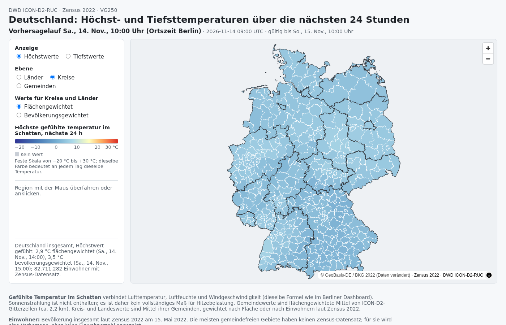

# 24h temperature forecast for Berlin neighborhoods

> **Two parts in one repository.** The original Berlin capstone (tag
> `v1.0-capstone-submitted`) is described below. Since v2.0 the repository also
> holds a **Germany layer** that extends the same pipeline to Bund, Länder,
> Kreise and Gemeinden; see [Germany layer](#germany-layer) at the end.

A reproducible geospatial data pipeline that combines current DWD temperature
forecasts, 31 years of historical temperature, and official population data for
Berlin's 542 planning areas.

The final PostgreSQL view gives analysts named neighborhoods, neighborhood-level
temperature and shade apparent temperature, comparable neighborhood and
citywide historical reference values, and the number of residents aged 65 or
older.

- heterogeneous source formats and grains transformed into one traceable PLR-level serving grain
- different forecast, historical, and administrative geometries are reconciled using versioned PostGIS intersection bridges with area weighting
- condensing large nationwide and multi-decade inputs: filter early, join on bridges, aggregate monthly, and delete validated monthly source files
- replicable and quick startup: clean installation in ten minutes thanks to validated checksum-verified artefacts (instead of several-hours full historical rebuild)

**The pipeline at a glance:**  
- Partitioned batch pipeline (multi-dimensional: run_time × lead_time)
- persistent source data in `raw`, 3NF tables in `normalized`, one fully denormalized OBT view served to analysts
- Dagster software-defined assets with asset lineage, asset checks as data-quality gates, and a sensor-based trigger
- PostGIS geospatial ETL:area-weighted spatial joins, reusable intersection bridge tables, CRS reprojection
- SQL-based data contracts plus pytest "contract" tests
- checksum-verified, manifest-driven snapshot distribution for the historical reference (~220MB analysis-ready artefact instead of reprocessing 220GB source data)

## Run a forecast and inspect the result

After completing the [one-time installation and bootstrap](#install-and-initialize),
run these two commands from the project root. On GNU/Linux, the first processes
a forecast from approximately two hours ago:

```bash
uv run --env-file .env python -m src.run_forecast \
  --run-time "$(date -u -d '2 hours ago' +%Y%m%dT%H00)"
```

The second queries the final analytical view using the PostgreSQL credentials
already configured inside the database container:

```bash
docker compose --env-file .env -f docker/postgres.yml \
  exec -T postgres \
  sh -c 'psql -U "$POSTGRES_USER" -d "$POSTGRES_DB" -c "
    SELECT
      plr_id,
      plr_name,
      valid_time_berlin,
      ROUND(temperature_c::numeric, 1) AS temperature_c,
      ROUND(apparent_temperature_shade_c::numeric, 1)
        AS apparent_temperature_c,
      ROUND(plr_temperature_median_c::numeric, 1)
        AS historical_median_c,
      population_65plus
    FROM analytical.current_plr_weather_context
    ORDER BY plr_id
    LIMIT 10;
  "'
```

Example result:

| PLR ID | Neighborhood | Berlin-local time | Temperature °C | Apparent °C | Historical median °C | Residents 65+ |
| --- | --- | --- | ---: | ---: | ---: | ---: |
| `01100101` | Stülerstraße | 2026-08-24 18:00 | 20.8 | 19.5 | 22.6 | 700 |
| `01100102` | Großer Tiergarten | 2026-08-24 18:00 | 20.8 | 19.6 | 22.7 | 291 |
| `01100103` | Lützowstraße | 2026-08-24 18:00 | 20.8 | 19.5 | 22.7 | 1,106 |

Forecast run labels use UTC; very recent runs may not yet be published and
older runs may have left DWD's rolling availability window. A complete
partition contains all 542 planning areas. The Dagster UI is not required.

## Run the complete 25-point temperature forecast

This feature branch also supports a complete 24-hour horizon: lead hours 0
through 24 produce **25 hourly observations for each of Berlin's 542 PLRs**.
For an existing installation, install the additive serving views once:

```bash
bash scripts/bootstrap_database.sh
```

Run all forecast partitions sequentially, automatically skipping any that are
already complete:

```bash
uv run --env-file .env python -m src.run_forecast_horizon \
  --run-time "$(date -u -d '2 hours ago' +%Y%m%dT%H00)"
```

Inspect the compact neighborhood summary:

```bash
docker compose --env-file .env -f docker/postgres.yml \
  exec -T postgres \
  sh -c 'psql -U "$POSTGRES_USER" -d "$POSTGRES_DB" -c "
    SELECT
      plr_name,
      ROUND(max_forecast_temperature_c::numeric, 1) AS maximum_c,
      max_forecast_temperature_at_berlin AS maximum_at,
      ROUND(max_temperature_difference_c::numeric, 1)
        AS maximum_above_historical_median_c,
      ROUND(sum_temperature_difference_c::numeric, 1)
        AS sum_of_hourly_differences_c,
      population_65plus
    FROM analytical.current_plr_temperature_summary_25h
    ORDER BY max_temperature_difference_c DESC
    LIMIT 10;
  "'
```

The separate `analytical.current_plr_temperature_forecast_25h` view provides
all 13,550 plotting points, including forecast temperatures, corresponding
PLR-specific historical medians, and signed differences. Both views switch to
a newer model run only after all 25 lead times are complete. These two views
require only the existing historical-reference snapshot.

If your database also contains the original HOSTRADA hourly observations,
optionally extract a separate historical line for every year from 1995 to
2025. This reuses the current complete forecast without contacting DWD:

```bash
uv run --env-file .env python -m src.historical_temperature_trajectories
```

The resulting `analytical.current_plr_temperature_history_25h` view contains
420,050 plotting observations: 542 neighborhoods, 25 lead hours, and 31
historical years. The compact reference archive alone cannot reconstruct these
individual observations, and ordinary installations do not need this feature.

## Explore the interactive Berlin map locally

After the 25-hour forecast and optional historical trajectories are ready,
export the current results and start a local preview:

```bash
uv run --env-file .env python -m src.export_temperature_dashboard --serve
```

Open <http://127.0.0.1:8765/>. Hover over a planning area to inspect its
25-hour summary and compare temperature or apparent-temperature forecasts with
their historical medians and each individual year from 1995 through 2025.
Search and click-to-pin also support keyboard and touch use.

The dashboard is plain HTML, CSS, SVG, JavaScript, and static JSON. It has no
frontend package, map-tile, CDN, or production database dependency. The same
folder can therefore be uploaded to a static website. See
[docs/static-temperature-dashboard.md](docs/static-temperature-dashboard.md)
for iteration, export, and deployment details.

## Start here

| Document | Use it when you want to... |
| --- | --- |
| [architecture.md](architecture.md) | Understand data sources, layers, spatial joins, orchestration, and the serving contract. |
| [runbook.md](runbook.md) | Install, operate, inspect, troubleshoot, or reset the pipeline. |
| [docs/data-sources.md](docs/data-sources.md) | Check source contracts, acquisition behavior, licenses, and attribution. |
| [docs/distribution.md](docs/distribution.md) | Obtain, verify, or publish the external installation archives. |
| [docs/testing.md](docs/testing.md) | Choose the small set of tests appropriate to your environment. |
| [docs/static-temperature-dashboard.md](docs/static-temperature-dashboard.md) | Preview and publish the interactive PLR map as static files. |
| [docs/historical-rebuild.md](docs/historical-rebuild.md) | Optionally reconstruct the HOSTRADA reference from original DWD data. |
| [docs/adr/README.md](docs/adr/README.md) | Review the principal architectural decisions and their tradeoffs. |

## What you need

- Linux or another environment that can run Docker and Docker Compose.
- Python 3.11, installed or managed by `uv`.
- `uv`, Docker Engine, and the Docker Compose plugin.
- Internet access to Python packages, the PostGIS image, Berlin Open Data, and
  the DWD Open Data server; an optional static snapshot can replace source
  downloads after dependencies and the container image are installed.
- The separately distributed HOSTRADA reference archive,
  `hostrada-reference-1995-2025.pgcustom`.
- Sufficient local disk space for PostgreSQL, the 201 MB compressed ICON grid,
  the 232 MB reference archive, and the resulting database tables and indexes.

Python dependencies are declared in `pyproject.toml`, locked in `uv.lock`, and
installed together with the `ecCodes`, PostGIS-client, and geospatial bindings
needed by the project. PostgreSQL and PostGIS run in Docker; application code
runs in the locked Python environment.

## Install and initialize

Clone the repository and enter its root:

```bash
git clone <repository-url> berlin-temperature-context
cd berlin-temperature-context
```

Create the local configuration and choose a PostgreSQL password:

```bash
cp .env.example .env
```

Install the exact locked Python environment:

```bash
uv sync --frozen
```

Start PostgreSQL/PostGIS:

```bash
docker compose --env-file .env -f docker/postgres.yml up -d
```

Use persistent project-local Dagster state:

```bash
export DAGSTER_HOME="$PWD/.dagster_home"
```

Download the compressed HOSTRADA reference file: [link](https://www.ohexel.com/files/hostrada-reference-1995-2025.pgcustom)

Initialize the complete operational pipeline:

```bash
uv run --env-file .env python -m src.bootstrap \
  --reference-archive /path/to/hostrada-reference-1995-2025.pgcustom
```

If you also have the optional static-source archive, provide it as a verified
fallback for unavailable geography, population, or ICON-grid downloads:

```bash
uv run --env-file .env python -m src.bootstrap \
  --reference-archive /path/to/hostrada-reference-1995-2025.pgcustom \
  --static-snapshot /path/to/static-inputs.tar.xz
```

Add `--offline` to use that snapshot directly instead of attempting static
source downloads. The initial clean-room bootstrap took approximately ten
minutes on the development laptop. Subsequent runs preserve existing data,
validate completed static inputs, and do not reimport an already valid
historical reference.

A successful bootstrap reports `"status": "ready"`. It does not download the
1995–2025 historical HOSTRADA archive.
The official 542-PLR name directory is acquired automatically; a verified,
64 KB workbook included in the repository supplies its offline fallback.

## Orchestration and tests

Inspect the registered jobs and assets:

```bash
uv run --env-file .env dg list defs
```

Start the Dagster interface:

```bash
uv run --env-file .env dagster dev \
  -m src.dagster_pipeline.definitions
```

The forecast availability sensor is intentionally **stopped by default**. Start
`dwd_icon_d2_ruc_availability_sensor` manually in the Dagster interface when
automated ingestion is desired. It checks whether all required forecast fields
are available before launching a run.

For an optional background interface on this branch, see
[containerized Dagster](docs/optional-dagster-container.md). The normal
host-based commands and PostgreSQL installation remain unchanged.

Run the default database-independent test suite:

```bash
uv run python -m pytest
```

After completing the operational bootstrap and processing at least one
forecast, run the end-to-end acceptance checks:

```bash
uv run --env-file .env python -m pytest \
  -m "acceptance and not historical_rebuild"
```

See [docs/testing.md](docs/testing.md) for focused data contracts, database
integration checks, and the optional historical-rebuild suite.

## What is distributed separately

| Artifact | Required? | Size | Purpose |
| --- | --- | ---: | --- |
| `hostrada-reference-1995-2025.pgcustom` | Yes | 231,645,982 bytes | Precomputed PLR and Berlin historical references. |
| `static-inputs.tar.xz` | Optional | 198,011,500 bytes | Verified fallback copies of LOR geography, population, and the ICON grid. |

Expected archive checksums and contents are recorded under `snapshots/`; see
[docs/distribution.md](docs/distribution.md). Neither archive belongs in Git.

## Scope and data interpretation

The pipeline provides **shade apparent temperature**, derived from air
temperature, relative humidity, and wind. It does not incorporate solar
radiation and therefore does not claim to calculate comprehensive heat stress.

The HOSTRADA reference uses the current 542-PLR geography, the years 1995–2025,
Berlin-local calendar hours, and median/p90/maximum values. Historical February
29 is excluded. Daylight-saving gaps and repeated hours are preserved according
to the `Europe/Berlin` timezone rules.

Geography-version identifiers, population reference dates, source provenance,
and quality diagnostics remain available below the serving layer. Analysts
receive measurements and essential time/geographic context rather than
predefined thresholds, classifications, or exposure estimates.

## Germany layer

The Germany layer extends the pipeline from Berlin's 542 planning areas to
every administrative level of Germany: Bund → 16 Länder → 400 Kreise → 10,990
Gemeinden. For each Gemeinde it combines the current 24-hour DWD ICON-D2-RUC
forecast (air temperature and shade apparent temperature, area-weighted from
the model grid) with Zensus 2022 total population, rolls the values up to
Kreis, Land and Bund with both an area and a population weighting, checks the
results against the sources, and shows them on a static MapLibre map. Berlin
tables, views, the sensor and the Berlin dashboard are unchanged; Germany
objects carry the prefix `de_`.



*Highest shade apparent temperature over the next 24 hours by Kreis,
area-weighted (forecast run 2026-11-14 09:00 UTC). The page is in German; a
switch shows the lowest values instead (Höchstwerte / Tiefstwerte). The colour
scale is fixed from -20 to +30 °C, so a colour means the same temperature on
every day.*

### Run it

```bash
# once: VG250 and Zensus raw loads, hierarchy, population, grid subset, bridge
uv run --env-file .env python -m src.germany.run_static

# per forecast run (UTC label; DWD keeps runs for about 24 hours)
uv run --env-file .env python -m src.germany.run_forecast \
  --run-time "$(date -u -d '3 hours ago' +%Y%m%dT%H00)"

# export the map and open a local preview (http://127.0.0.1:8766/)
uv run --env-file .env python -m src.export_germany_dashboard --serve

# acceptance tests on the installed data (read-only)
uv run --env-file .env python -m pytest -m acceptance tests/test_germany_acceptance.py
```

`run_static` needs a free Zensus API token (`ZENSUS2022_TOKEN` in `.env`) only
when the Zensus files are not yet under `data/raw/germany/`. Building the
boundary tiles needs `tippecanoe` once. Details and measurements:
[docs/germany-layer.md](docs/germany-layer.md) and
[docs/germany-layer-facts.md](docs/germany-layer-facts.md).

### Example query

The five Kreise with the highest 24-hour maximum of shade apparent temperature,
weighted by population:

```sql
SELECT kreis_name, land_name,
       max_apparent_temperature_shade_population_weighted_c,
       max_apparent_temperature_shade_population_weighted_at_berlin
FROM analytical.de_current_kreis_summary
ORDER BY 3 DESC
LIMIT 5;
```

### Checks against the sources

| # | Check | What it tests |
| --- | --- | --- |
| 1 | `de_key_coverage` | every VG250 Gemeinde has a Zensus record and the reverse; exceptions are listed |
| 2 | `de_hierarchy_integrity` | what foreign keys cannot guarantee: no empty parents, consistent Land, key parts agree with VG250, areas add up |
| 3 | `de_source_totals` | sums of Gemeinde population equal the published Kreis and Land totals; the Germany total differs by the documented 8,258 |
| 4 | `de_bridge_coverage` | each Gemeinde is covered by grid cells (sum of intersection areas / area ≥ 0.999) |
| 5 | `de_forecast_completeness` | all Gemeinden × 25 lead times exist before the current views switch to a new run |
| 6 | `de_forecast_plausibility` | temperatures within physical bounds, no NULLs |
| 7 | `de_berlin_cross_layer_consistency` | Berlin as one Gemeinde agrees with the roll-up of its 542 planning areas (tolerance 0.01 °C, warning) |

Two more checks verify that the raw VG250 and Zensus files match their pinned
checksums and counts.

### Adding a further theme

The hierarchy does not change when a theme is added. A new theme is one table
keyed by the geography version and a regional key (Gemeinde, Kreis or Land),
plus the same roll-up pattern, its own source contract (URL, reference date,
licence, checksum) and checks against the source's published totals. As a
candidate for a next theme, the Bundesagentur für Arbeit publishes employees
and establishments per Gemeinde; in its 30 June 2025 file, 10,748 of 10,752
Gemeinde keys match the VG250 keys used here (measured 14 Nov 2026).

### Limitations

- Forecast only. There is no Germany-wide historical reference; HOSTRADA history
  stays Berlin-only.
- Population is Zensus 2022 (reference date 15 May 2022, Gebietsstand 15 May
  2022); VG250 boundaries have the status of 31 Dec 2022.
- VG250 is a generalised 1:250,000 geometry.
- Shade apparent temperature does not include solar radiation (as in Berlin).
- The values are measurements: no thresholds, classes or exposure scores.
- A portfolio project run on a local machine, not an operated service.

### Licences and attribution

Boundaries: © GeoBasis-DE / BKG 2022 (Daten verändert), dl-de/by-2-0.
Population: Zensus 2022, © Statistische Ämter des Bundes und der Länder,
Deutschland, 2026, dl-de/by-2-0. Forecast: Deutscher Wetterdienst (DWD),
ICON-D2-RUC, CC BY 4.0. Aggregation by this project; not an official
publication. Sources, checksums and licences are listed in
[docs/data-sources.md](docs/data-sources.md).

### Decisions

[ADR 014](docs/adr/014-equal-area-projection-for-germany.md) (equal-area
projection),
[ADR 015](docs/adr/015-rollup-weighting.md) (roll-up weighting),
[ADR 016](docs/adr/016-map-pmtiles-and-json-values.md) (map: PMTiles and JSON),
[ADR 017](docs/adr/017-zensus-2022-population-and-source-checks.md) (Zensus
and source checks),
[ADR 018](docs/adr/018-sql-aggregation-and-cell-storage.md) (SQL aggregation
and cell storage).
