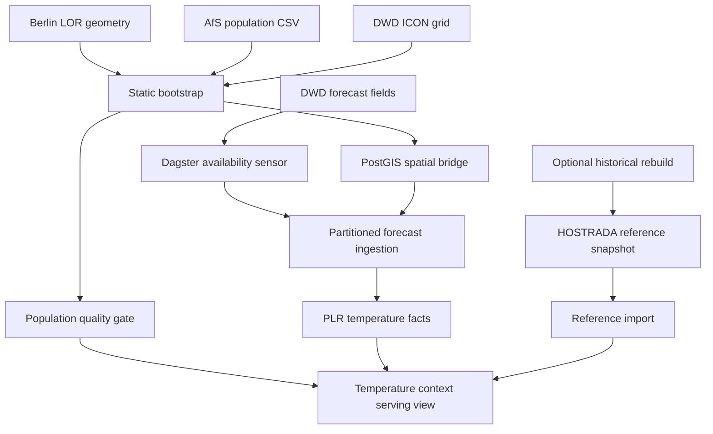

# Architecture

## Problem and serving grain

Urban-planning and public-health analysts need neighborhood-level temperature
observations, historical context, and population counts on the same spatial
and temporal grain. The pipeline serves facts from which analysts can make
their own comparisons; it does not assert a medical risk classification.

One final serving row represents one current Berlin planning area, one forecast
run, and one forecast lead time. Forecast valid time is derived from run time
plus lead time. Historical reference values are matched to the corresponding
Berlin-local calendar month, day, and hour.

## System overview



Python owns source-specific acquisition, GRIB/NetCDF decoding, and operational
coordination. PostgreSQL/PostGIS owns durable relational state, spatial
intersections, constraints, set-based transformations, and serving views.
Dagster owns asset lineage, partition execution, quality checks, run history,
and source-aware triggering. Docker isolates PostgreSQL/PostGIS; the application
uses a reproducible `uv` environment.

This is a source-aware **batch pipeline** with hourly forecast partitions. It
is not a streaming platform, medical decision system, or dashboard product.

The Germany layer described under [Germany layer](#germany-layer) extends this
pipeline to Bund, Länder, Kreise and Gemeinden with its own, `de_`-prefixed
relations in the same three schemas.

## Source systems

| Source | Grain | Refresh behavior | Operational role |
| --- | --- | --- | --- |
| Berlin LOR planning areas | 542 polygons, geography dated 2023-01-01 | Slowly changing | Stable PLR identifiers and geometry. |
| Berlin PLR name directory | 542 planning-area identifiers and names | Slowly changing | Analyst-facing neighborhood labels only. |
| AfS population register | PLR, reference date 2025-12-31 | Slowly changing | Total residents and residents aged 65+. |
| DWD ICON grid 0047 | 542,040 cells and 272,089 vertices | Static model grid | Forecast-cell geometry and spatial bridge. |
| DWD ICON-D2-RUC | Forecast run, lead time, grid cell, indicator | Rolling forecast publication | Temperature, humidity, and wind fields. |
| DWD HOSTRADA | Historical hour and 1 km grid cell | Historical reference, 1995–2025 | Neighborhood and Berlin historical comparisons. |

Operational installation imports the completed HOSTRADA reference. Original
historical NetCDF files, the HOSTRADA spatial bridge, and historical hourly
tables are required only when deliberately reconstructing that reference.

## Durable data layers

| PostgreSQL schema | Responsibility | Representative relations |
| --- | --- | --- |
| `raw` | Source-faithful records and ingestion provenance. | `lor_plr`, `afs_population`, `icon_grid_source`, `icon_d2_ruc_field` |
| `normalized` | Validated geometry, accepted/rejected population, spatial weights, and normalized forecast fields. | `plr`, `plr_population_65plus`, `plr_population_rejected`, `icon_cell`, `icon_plr_area_bridge`, `icon_weather_mask`, `icon_d2_ruc_weather` |
| `analytical` | PLR-level temperature facts, historical reference tables, analyst-facing labels, and consumer-facing views. | `plr_weather_population`, `plr_display_name`, `hostrada_plr_hourly_reference`, `hostrada_berlin_hourly_reference`, `current_plr_weather_context` |

Raw forecast GRIB files also remain on the filesystem. Their stable directory
layout mirrors `(run_time_utc, lead_time, indicator)` and permits reprocessing
after DWD removes an older run from its rolling source window.

## Static initialization

The supported operational entry point is:

```bash
uv run --env-file .env python -m src.bootstrap \
  --reference-archive /path/to/hostrada-reference-1995-2025.pgcustom
```

It first checks the archive bytes against the committed manifest, before
starting expensive static processing. It then:

1. Applies `sql/bootstrap_schema.sql` once to an empty database, or verifies
   that an existing database already satisfies the canonical schema contract.
2. Acquires LOR geometry, population data, and the ICON grid; an optional
   static-source archive supplies a verified fallback.
3. Runs the Dagster `operational_static_bootstrap` job and validates the
   resulting geometry, population, spatial bridge, and Berlin forecast mask.
4. Confirms that installed PLR identifiers match the reference geography
   fingerprint.
5. Restores the two historical-reference tables in one PostgreSQL transaction.
6. Validates the imported reference independently of historical source
   manifests or 1995–2025 hourly observations.
7. Installs 542 verified PLR display names for the final analyst-facing views.

On the development laptop, the first clean-room installation took
approximately ten minutes. Its largest one-time operation was processing the
ICON grid: 272,089 vertices, 542,040 cells, and 1,626,120 topology records.

## Forecast identity and ingestion

The canonical forecast key is:

```text
run_time_utc + lead_time
```

`valid_time_utc = run_time_utc + lead_time`. Run labels such as
`20260824T1600` always represent UTC. A Dagster sensor examines only recent
advertised DWD runs and triggers a partition when all four required fields are
present:

- `T_2M`: air temperature.
- `RELHUM_2M`: relative humidity.
- `U_10M`: east-west wind component.
- `V_10M`: north-south wind component.

The sensor checks during minutes `:30`–`:59`, is stopped by default, and must
be enabled explicitly. Manual execution performs the same source-completeness
preflight while still allowing complete retained raw partitions to be
reprocessed without contacting DWD.

The forecast pipeline retains and validates full GRIB source fields, selects
the 465 Berlin forecast-mask cell indices from each decoded array in Python,
and copies only those values into PostgreSQL. It then computes shade apparent
temperature and area-weights both temperature measures to PLRs. Full-grid
point counts and missing-value accounting remain recorded in the source
manifest even though nationwide values do not cross the database boundary.

## Spatial and population contracts

Forecast grid cells and PLRs use different geometries. PostGIS constructs a
many-to-many intersection bridge in EPSG:25833; PLR temperature is weighted by the
fraction of each planning area's area represented by each intersecting cell.
Bridge checks protect complete PLR coverage and weight totals.

Population records are validated before entering the analytical layer. The
observed source contains 542 PLR records: 540 accepted and two rejected. A
rejected record remains represented in the final view with null population
counts and `population_status = 'rejected_source_record'`. Missing population
is never represented as zero.

## Historical reference contract

The historical reference is built from HOSTRADA version 1.0 for 1995–2025,
using the current PLR geography rather than historical boundary versions.

For each local month/day/hour, the reference retains the median, 90th
percentile, and observed maximum of both air temperature and shade apparent
temperature. PLR-specific and Berlin-wide results occupy separate tables:

| Relation | Expected rows |
| --- | ---: |
| `analytical.hostrada_plr_hourly_reference` | 4,747,920 |
| `analytical.hostrada_berlin_hourly_reference` | 8,760 |

Calendar groups are derived using `Europe/Berlin`. February 29 is excluded;
repeated autumn UTC observations remain separate samples; missing spring
hours are not fabricated. The 8,760 Berlin groups contain 271,559 historical
observations in total. Group sample counts vary according to actual historical
timezone rules.

Forecast and historical temperature values are produced on different source
grids. The
serving join uses the shared, versioned PLR geography and local calendar key;
it never incorrectly equates the ICON and HOSTRADA grid identifiers.

## Final serving contract

`analytical.plr_weather_context` exposes every forecast partition.
`analytical.current_plr_weather_context` exposes the current partition.
Both views have the same 23 columns:

| Category | Columns |
| --- | --- |
| Geography | `plr_id`, `plr_name` |
| Forecast time | `run_time_utc`, `lead_time`, `valid_time_utc`, `valid_time_berlin` |
| Forecast observations | `temperature_c`, `apparent_temperature_shade_c` |
| PLR air-temperature reference | `plr_temperature_median_c`, `plr_temperature_p90_c`, `plr_temperature_max_c` |
| PLR apparent-temperature reference | `plr_apparent_temperature_median_c`, `plr_apparent_temperature_p90_c`, `plr_apparent_temperature_max_c` |
| Berlin air-temperature reference | `berlin_temperature_median_c`, `berlin_temperature_p90_c`, `berlin_temperature_max_c` |
| Berlin apparent-temperature reference | `berlin_apparent_temperature_median_c`, `berlin_apparent_temperature_p90_c`, `berlin_apparent_temperature_max_c` |
| Population | `population_total`, `population_65plus`, `population_status` |

Display names are presentation-only and may be duplicated: PLR identifiers
remain the sole engineering and spatial join key. Missing names cannot remove
forecast rows because the final label lookup uses a left join.

Historical joins are left joins. Forecasts occurring on Berlin-local February
29 remain visible with null historical comparisons. Geography version,
population reference date, source checksums, sample counts, threshold flags,
and exposure classifications stay out of the serving contract.

### Complete 25-point forecast and neighborhood summary

The feature branch adds two separate, presentation-oriented views without
changing the existing 23-column single-partition contract:

| Relation | Grain | Expected rows |
| --- | --- | ---: |
| `analytical.current_plr_temperature_forecast_25h` | One PLR and one forecast lead hour, 0–24. | 13,550 |
| `analytical.current_plr_temperature_summary_25h` | One PLR across the complete forecast horizon. | 542 |
| `analytical.current_plr_temperature_history_25h` | One PLR, forecast lead hour, and historical year, 1995–2025; optional. | 420,050 |

Both views select the newest model run containing all 25 lead hours for all
installed PLRs. A newer incomplete run never displaces a previous complete
horizon. Public forecast timestamps are expressed in Berlin local time.

For each PLR, the summary reports the highest forecast temperature and its
earliest local occurrence, the largest **signed** forecast-minus-historical-
median difference and its earliest occurrence, the sum of all 25 signed
difference, the largest apparent-minus-forecast temperature difference, and
the existing population values/status. A negative maximum
difference remains negative when every forecast hour is below its historical
median; absolute differences are never substituted.

The detailed plotting view reads only the established forecast context and its
already-installed reference medians. It does not read, rebuild, or retain the
147-million-row HOSTRADA historical observation table.

Individual historical-year trajectories are a separate, explicitly opted-in
extension. They require the original populated
`analytical.hostrada_plr_hourly` table, rather than the compact reference
snapshot. PostgreSQL resolves each forecast hour to the same Berlin-local
calendar hour in historical years 1995–2025, then uses both leading columns of
the source table's existing `(source_month_utc, valid_time_utc, plr_id)`
primary key for 775 targeted timestamp lookups.

The resulting `analytical.plr_temperature_history_25h` table retains only the
current horizon's 420,050 rows, each containing temperature and apparent
temperature. Its plotting view adds the existing analyst-facing PLR name,
corresponding forecasts, and historical medians. Historical extraction is
transactional, repeatable, and
never changes the original hourly observations, compact reference tables,
existing forecast view, or neighborhood summary.

### Static temperature dashboard

The optional presentation export reads the three 25-hour serving views and
`normalized.plr`, simplifies the EPSG:25833 boundaries in PostGIS, and writes
a self-contained static folder. One map file contains 542 geometries and their
compact summaries. One small detail file per PLR contains 25 forecast and
median points for temperature and apparent temperature, plus 31 historical-year
trajectories for both indicators; the browser requests a detail only when that
neighborhood is selected.

The browser draws projected PLR boundaries and line charts directly in SVG
using local HTML, CSS, and JavaScript. It uses no map tiles, frontend framework,
CDN, API endpoint, or live database connection. This keeps PostgreSQL
credentials out of the website and makes the exported folder deployable on an
ordinary static host.

## Germany layer

The Germany layer follows the same `raw` → `normalized` → `analytical` layering
and the same Dagster code location. Every relation carries the prefix `de_`;
the Berlin relations, views, sensor and tests are not changed. The layer reads
Berlin's ICON cell polygons (`normalized.icon_cell`) and the Berlin function
`normalized.calculate_apparent_temperature_shade_c`, and writes only `de_`
objects. Operation and measurements are in
[docs/germany-layer.md](docs/germany-layer.md); decisions are in ADRs
[014](docs/adr/014-equal-area-projection-for-germany.md) to
[020](docs/adr/020-sector-data-kreis-groups-and-land-divisions.md). Three themes
use the hierarchy: the temperature forecast, employment per Gemeinde (v2.1)
and employees by sector per Kreis and Land (v2.2), the last two from the
Statistik der Bundesagentur für Arbeit.

### Sources

| Source | Grain | Refresh behavior | Operational role |
| --- | --- | --- | --- |
| BKG VG250 | Staat, Länder, Kreise, Gemeinden; status 31 Dec 2022, EPSG:25832 | Static (one vintage, checksum pinned) | Administrative hierarchy and geometry. |
| Zensus 2022 table 1000A-1003 | Länder, Kreise, Gemeinden; reference date 15 May 2022 | Static (one census, checksum pinned) | Total population per region and the published totals for the source checks. |
| DWD ICON-D2-RUC | Forecast run, lead time, grid cell | Rolling publication (shared with Berlin) | Temperature, humidity and wind fields. |
| BA Regionalreport über Beschäftigte (product 709) | Kreise; quarterly, five quarters per file | Quarterly (about six months after the quarter); one file per Kreis; structure contract | WZ sections and three manufacturing groups. |
| BA Beschäftigte nach Wirtschaftszweigen | Länder and Germany; quarterly | Quarterly; one file per Land; structure contract | Every WZ division (motor vehicles, mechanical engineering, chemicals, steel). |
| BA Gemeindedaten (product 229) | Germany, Länder, Kreise, Gemeinden; reference date 30 June, territorial status of that date | Yearly (January); structure contract for every vintage, checksum pinned for the known one | Employees by place of residence and of work, commuters, establishments. |

### Relations by layer

| Schema | Relations |
| --- | --- |
| `raw` | `de_vg250`, `de_zensus2022_population`, `de_ba_gemeindedaten`, `de_ba_regionalreport`, `de_ba_wz_heft` |
| `normalized` | `de_land`, `de_kreis`, `de_gemeinde` (hierarchy, EPSG:3035 geometry, area), `de_gemeinde_population`, `de_zensus_published_population`, `de_icon_cell`, `de_icon_cell_gemeinde_bridge`, `de_forecast_run`, `de_icon_cell_value`, `de_gemeinde_forecast`; `de_indicator_source`, `de_indicator`, `de_indicator_value` (theme-independent indicators, ADR 019), `de_indicator_sum_component` (declared sums), `de_indicator_quality_note` (reviewed source discrepancies) |
| `analytical` | `de_current_run`; `de_current_{gemeinde,kreis,land,bund}_forecast_25h`; `de_current_{gemeinde,kreis,land,bund}_summary`; `de_current_employment`; `de_current_sectors` |

Kreis, Land and Bund values are rolled up from Gemeinden with an area and a
population weighting (ADR 015). The `_summary` views hold the 24-hour maximum
and minimum of each measure and its time, with one rule for all four levels
(highest or lowest value, earliest time on a tie). The
`de_current_*` views show the newest run in which every Gemeinde has all 25
lead times, the same switching rule as Berlin's 25-hour views.

### Orchestration

Five jobs in the group `germany`:

| Job | Command | What it does |
| --- | --- | --- |
| `germany_static` | `python -m src.germany.run_static` | VG250 and Zensus raw loads, hierarchy, population, grid subset and bridge, checks 1–4. Safe to repeat: an existing geography version from the same file is left unchanged. |
| `germany_forecast` | (one partition per lead time, started by the next command) | The four raw DWD fields (shared with Berlin, files only) and the Germany aggregation in SQL. |
| `germany_forecast_publish` | `python -m src.germany.run_forecast --run-time …` | Runs all 25 lead times, then publishes, applies retention and runs checks 5–7. |
| `germany_sectors` | `python -m src.germany.run_sectors [--file-date …]` | Downloads one quarter of both sector products (434 files, one request at a time with a 3 s pause; on HTTP 429 it waits minutes, then records a cool-down that every download and the sensor respect, and stops so the next run resumes), loads them raw, refreshes the sector values and runs checks 12–15. Started by `ba_sectors_release_sensor` (off by default) or by hand. |
| `germany_employment` | `python -m src.germany.run_employment [--reference-date …]` | Downloads one BA vintage, loads it raw, refreshes the indicator values and runs checks 8–11. Started by `ba_gemeindedaten_release_sensor` (daily HEAD request for the next vintage; off by default) or by hand. |

The Berlin availability sensor does not trigger these jobs and stays stopped
by default. Retention keeps the newest complete run and the one before it, as
database rows only; GRIB files follow Berlin's existing file rule.

### Checks

Seven asset checks compare the layer with its sources and itself (README,
"Checks against the sources"): key coverage and hierarchy integrity on the
normalized hierarchy, source totals on the population, bridge coverage on the
bridge, and completeness, plausibility and Berlin cross-layer consistency on
the published forecast. Two further checks pin the raw files to their
checksums and counts. The employment theme adds four: the BA file's
structure, identities between its columns, its keys against the hierarchy,
and its Gemeinde, Kreis and Land values against its own published totals.
The sector theme adds four more: the files' structure, identities within each
Kreis, totals across Kreise, Länder, both products and the Gemeindedaten, and
coverage of all Kreise and Länder.

### Map

`python -m src.export_germany_dashboard` writes a static folder in
`web/germany-dashboard/`: a PMTiles archive of Land, Kreis and Gemeinde
outlines (built once per geography version), one `values.json` per run and
one `employment.json` per BA vintage and one `sectors.json` per quarter,
joined in the browser by regional key (ADR 016). The page is in German and has
three themes: temperature (24-hour maxima or minima on a fixed scale from -20
to +30 °C), employment (jobs at place of work per employed resident on a fixed
logarithmic scale) and industry (share of metal, electrical and steel per
Kreis and Land, 0 to 40 %). The host must answer HTTP Range requests; the local preview
(`src/germany/preview_server.py`) does.

### Things to know

- Every job applies the idempotent Germany schema files first, so a
  forecast run applies them once per lead time. This is simple and safe; it is
  why no separate install step exists.
- Building tiles needs the program `tippecanoe`, once per geography version.
- The serving views compute on read; a query takes about 1.6 to 2.7 seconds.

### Adding a further theme

A theme that publishes values per region uses the indicator tables (ADR 019):
catalogue rows in `de_indicator_source` and `de_indicator`, a raw table as
delivered, a refresh function that writes `de_indicator_value` with an
explicit status for every region, a serving view, a source contract and
checks against the source's own published totals. The hierarchy and the
indicator tables do not change. A theme that is computed from a grid, like
the forecast, keeps its own tables and roll-ups.

## Failure boundaries and restart behavior

- The database bootstrap applies one canonical schema to an empty database and
  never truncates an existing compatible installation.
- Static-source fallback restores only verified files and refuses to overwrite
  conflicting local data.
- HOSTRADA reference import is atomic and rejects incompatible PLR geography.
- Dagster asset checks prevent incomplete partitions from being reported as
  successful.
- Forecast files and forecast-only PostgreSQL rows share a rolling retention
  window of at most 24 hours; retained files remain reprocessable within that
  window without relying on upstream availability.
- The 25-point forecast runner processes one lead at a time, resumes validated
  partitions, and publishes a horizon only after every PLR and lead is present.
- The optional historical backfill commits one validated month at a time and
  removes its large source files only after durable outputs pass validation.

Architectural tradeoffs are recorded under [docs/adr/](docs/adr/README.md).
